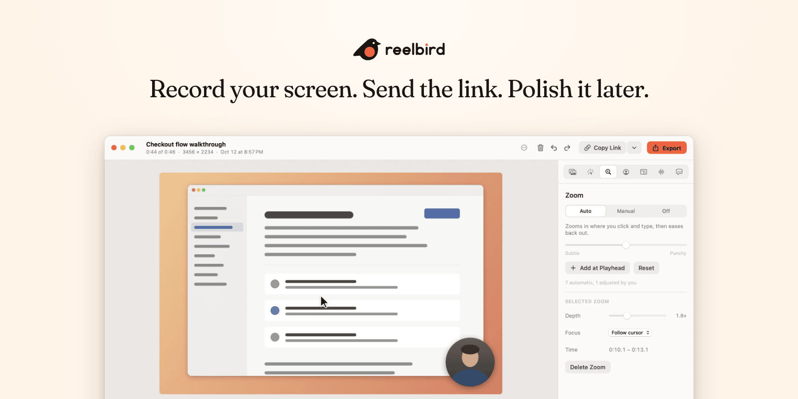
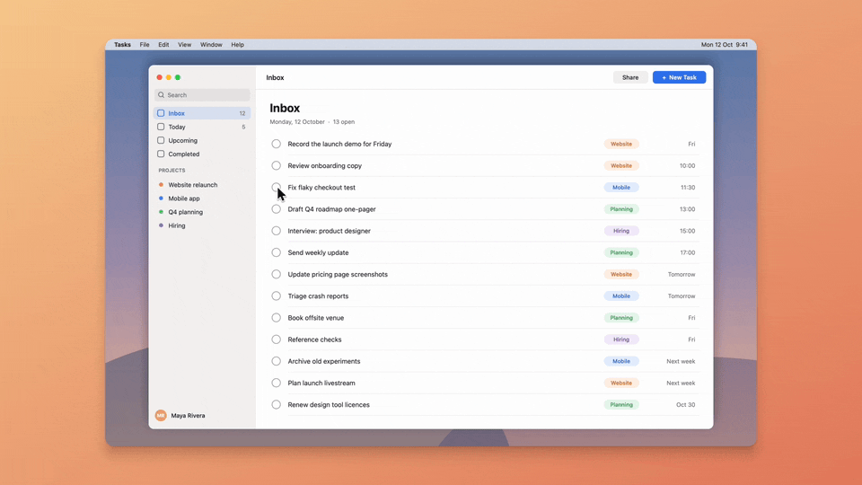
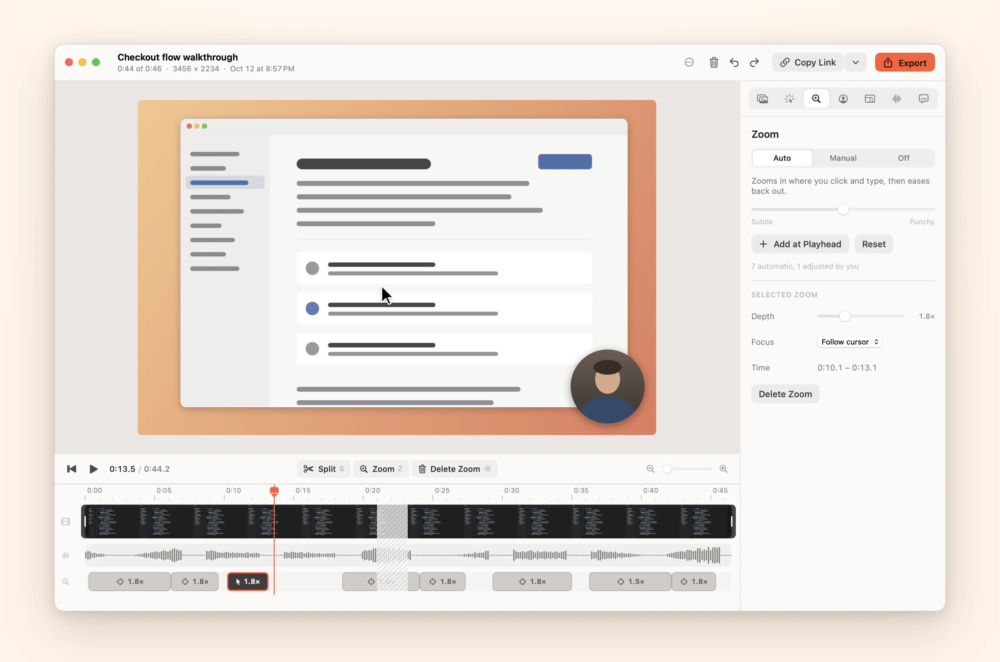
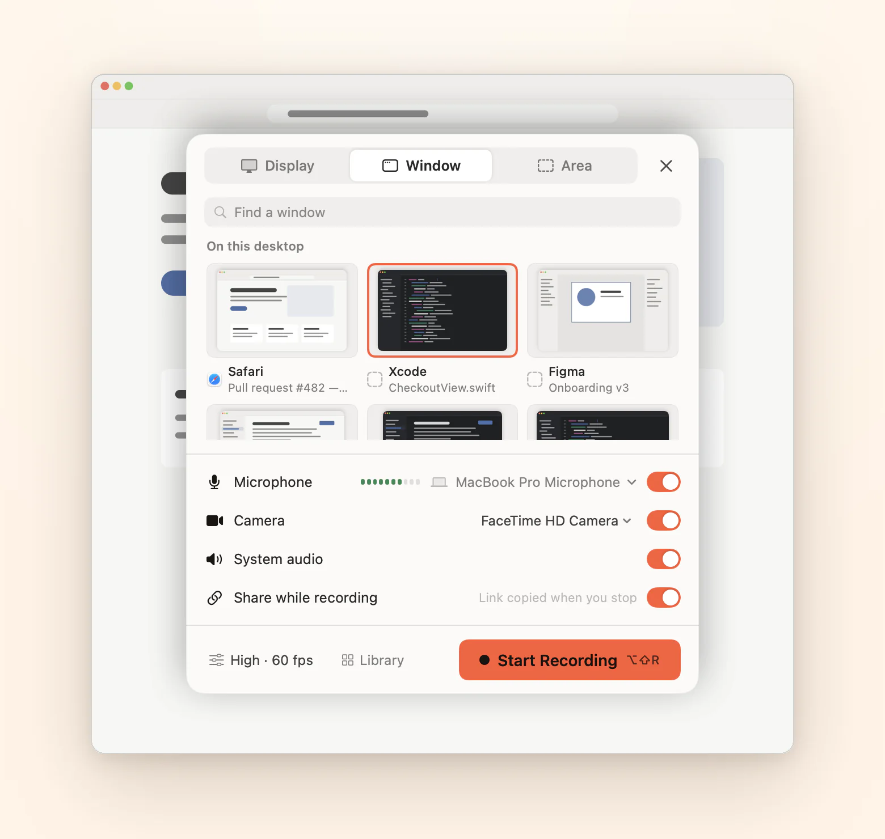
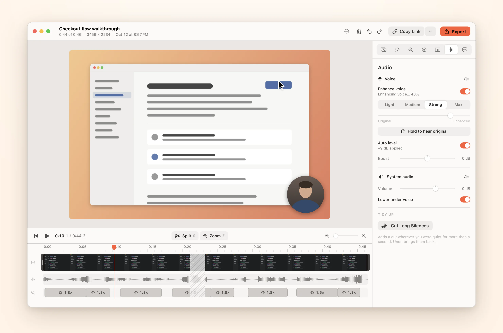
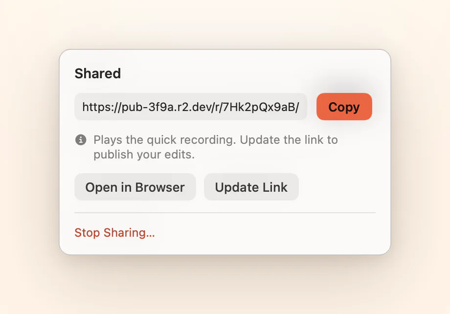

<p align="center">
  <picture>
    <source media="(prefers-color-scheme: dark)" srcset="brand/readme/banner-dark.png">
    
  </picture>
</p>

<p align="center"><b>Reelbird is a free, open-source screen recorder for macOS that copies a share link the moment you stop recording, then lets you polish the same take with auto-zoom, a smooth cursor and captions without changing the link.</b></p>

<p align="center">
  <a href="LICENSE"></a>
  
  
  
</p>

<p align="center">
  <a href="https://reelbird.shiptiffin.app">Website</a> ·
  <a href="#download">Download</a> ·
  <a href="#how-it-compares">Compare</a> ·
  <a href="#command-line">CLI</a> ·
  <a href="#mcp-server">MCP</a> ·
  <a href="docs/SHARING.md">Sharing setup</a> ·
  <a href="#troubleshooting">Troubleshooting</a> ·
  <a href="https://reelbird.shiptiffin.app/support/">Support</a>
</p>

<p align="center">
  
</p>

It's a native Swift app with no account, no telemetry and no Reelbird server: share links point at a storage bucket you own, such as Cloudflare R2. It includes a command-line tool and an MCP server, so coding agents can record and share demos too. You can download it (not yet notarised by Apple) or build it from source, on macOS 15 or later.

**Why not just use Loom or Screen Studio?** Loom's free plan stops each video at 5 minutes and won't let you download it; Screen Studio costs $29 a month and gives you a link only after you export. Reelbird gives you the link when you stop and the auto-zoom polish later, under the same link, for free. [How it compares](#how-it-compares).

## How it works

1. **Record.** Pick a display, a window or an area, with camera, microphone and system audio if you want them. Press ⌥⇧R from any app.
2. **Stop.** The link is already on your clipboard. Reelbird streamed the take to your bucket while you recorded, so it plays in any browser a moment later.
3. **Polish it later.** Open the same take. Reelbird has planned zooms on your clicks and typing, smoothed the cursor and levelled your voice. Trim, add captions, pick a background, then choose **Update link**. Everyone you sent the link to now sees the polished version.

<table>
  <tr>
    <td width="50%"><picture><source media="(prefers-color-scheme: dark)" srcset="brand/screenshots/editor-zoom-dark.webp"></picture></td>
    <td width="50%"><picture><source media="(prefers-color-scheme: dark)" srcset="brand/screenshots/picker-dark.webp"></picture></td>
  </tr>
  <tr>
    <td><picture><source media="(prefers-color-scheme: dark)" srcset="brand/screenshots/editor-audio-dark.webp"></picture></td>
    <td><picture><source media="(prefers-color-scheme: dark)" srcset="brand/screenshots/share-dark.webp"></picture></td>
  </tr>
</table>

## What it does

**Records what you need, as separate tracks.** A display, a window or an area, plus camera, microphone and system audio, with no virtual audio driver. Camera and audio stay on their own tracks, so you can move the camera bubble or mute system sound after recording.

**Keeps your take if the app quits.** Every track is written to disk in 2-second segments from the first frame. If Reelbird crashes or quits mid-recording, the take is recovered the next time Reelbird opens, minus at most the last two seconds.

**Warns you while it matters.** If the microphone is recording silence, capture stalls, audio drifts, the disk is filling up or uploads fall behind, you see it during the recording, not after.

**Auto-zoom and a smooth cursor.** Reelbird logs clicks, typing, scrolls and pointer movement next to the video, then plans zooms that follow them. One slider sets how much it zooms, from subtle to punchy, and you can add, move or delete zooms on the timeline. The cursor is redrawn from that log, so it glides instead of jittering, and you can resize or hide it after the fact. Preview and export use the same Metal renderer, so the export looks exactly like the preview.

**Audio that sounds finished.** **Auto level** brings your voice to a steady −16 LUFS with a true-peak limiter. **Enhance voice** removes background noise and evens out your voice on your Mac, with a strength control and a blend back to the original; the raw microphone track is never changed. **Lower under voice** turns system audio down while you talk.

**Instant share links to your own bucket.** With **Share while recording** on, Reelbird uploads a 1080p stream as you record and copies the link the moment you stop. After editing, **Update link** replaces the video and keeps the URL. Setup is in [docs/SHARING.md](docs/SHARING.md).

**Captions on your Mac.** Captions come from Apple's on-device speech recognition. Burn them into the export, or let viewers turn them on from the share page. **Cut Long Silences** removes the pauses in one go. From the command line, `reelbird suggest` writes a title and chapters with Apple's on-device model on Macs with Apple Intelligence. No API keys.

**Clean frames.** Backgrounds, padding, rounded corners, aspect ratios for every platform, a movable camera bubble, and **Hide Browser Toolbar** to crop the tabs and bookmarks bar off a browser window.

**Exports the usual formats.** MP4 (H.264), HEVC and ProRes with hardware encoding, plus GIF.

**Works with agents.** The `reelbird` command-line tool and its MCP server let Claude Code, Codex or Cursor list screens, record a demo of the change they just made, export it and hand you the link.

**Open project format.** A recording is a `.reelbird` folder of standard MP4 files, JSON and an event log, with relative paths. Nothing is locked in. See [docs/FORMAT.md](docs/FORMAT.md).

## How it compares

| | Reelbird | Loom | Screen Studio | Cap | OpenScreen |
|---|---|---|---|---|---|
| Price | Free | Free plan; Business $18/user/mo | $29/mo, or $9/mo billed yearly | Free for personal use; paid from $29/yr | Free |
| Free-plan limits | None | 25 videos, 5 min each, 720p | No free plan listed | Personal use, 5-min links | None |
| Open source | MIT | No | No | AGPLv3 (some parts MIT) | MIT |
| Link when you stop | Yes, to your own bucket | Yes, on Loom's cloud | After export | Yes (Instant mode) | No links |
| Auto-zoom and smooth cursor | Yes | No | Yes | Yes (Studio mode) | Yes |
| Polish an instant link later, same URL | Yes | No auto-zoom | Link comes after export | Instant and Studio are separate modes | No links |
| Download your video | Always | Business plans and up | Yes | Yes | Yes |
| Comments or viewer stats | No | Yes | Yes | Viewer analytics on Pro | No links |
| Platforms | Mac | Mac, Windows, web, mobile | Mac | Mac, Windows (beta), Linux | Mac, Windows, Linux |
| Notarised download | Not yet: approve once, or build from source | Yes | Yes | Yes | Yes |

Checked 12 October 2026 on each vendor's own pages: [Loom pricing](https://www.loom.com/pricing), [Loom downloads](https://support.atlassian.com/loom/docs/download-your-loom-video/), [Screen Studio](https://screen.studio/), [Cap pricing](https://cap.so/pricing), [OpenScreen](https://github.com/getopenscreen/openscreen). Loom is the better team tool and runs everywhere; Screen Studio has the more mature editor; Cap and OpenScreen run on Windows and Linux. More detail, plus CleanShot X, Tella and Screenity, at [reelbird.shiptiffin.app/compare](https://reelbird.shiptiffin.app/compare/).

## Download

[**Download Reelbird 0.1.0**](https://github.com/btahir/reelbird/releases/latest/download/Reelbird-0.1.0.zip) for Apple silicon Macs on macOS 15 or later (5.6 MB).

It isn't notarised by Apple yet, so macOS asks you to approve it once:

1. Unzip it and drag **Reelbird** to your Applications folder.
2. Open it. macOS says it can't verify the developer. Choose **Done**.
3. Open **System Settings → Privacy & Security**, scroll down and choose **Open Anyway** next to Reelbird.

After an update, macOS may ask for Screen Recording permission again, because the app isn't signed with an Apple Developer ID. Building from source avoids both steps. The SHA-256 of each zip is listed on its [release page](https://github.com/btahir/reelbird/releases).

## Install from source

Building it yourself takes a few minutes and needs no Xcode, and macOS trusts the result without the approval step.

You need:

- macOS 15 or later, on Apple silicon. It also compiles for Intel Macs that run macOS 15, but it hasn't been tested on one yet.
- The Command Line Tools for Xcode 26 or later (`xcode-select --install`), which bring Swift 6.2 and the macOS 26 SDK. They install on macOS 15.6 and later. Xcode 26 works too but isn't required.

```sh
git clone https://github.com/btahir/reelbird.git
cd reelbird
make install
```

`make install` builds a release copy of the app and copies it to `/Applications`, asking first if Reelbird is already there. Then open it:

```sh
open /Applications/Reelbird.app
```

Reelbird lives in the menu bar. Look for the robin.

Some Command Line Tools installs ship a stale SwiftPM file that breaks every `Package.swift`. The scripts detect this and work around it on their own (see `scripts/env.sh`), so you don't need to do anything. Run `make` to see every target.

### Permissions on first run

The welcome tour asks for each permission in turn. You can change them later in **Settings… → Permissions** or in **System Settings → Privacy & Security**.

| Permission | Needed for |
|---|---|
| Screen & System Audio Recording | Recording the screen and system sound. Required. |
| Microphone | Your voice. |
| Camera | The camera bubble. |
| Accessibility and Input Monitoring | Optional. The keystroke overlay (**Settings… → Recording → Record keystrokes**). |
| Speech Recognition | Captions on macOS 15 only. macOS 26 and later doesn't ask. |

**Screen Recording takes effect only after Reelbird reopens.** After you turn it on, choose **Quit & Reopen** in Reelbird (or quit it from the menu bar and open it again).

### Keep permissions across rebuilds (optional)

By default the app is signed ad hoc. That signature changes with every build, so macOS forgets the Screen Recording permission each time you rebuild. If you build often, create a local signing certificate once:

```sh
scripts/dev-signing.sh
export RB_SIGN_IDENTITY="Reelbird Local Signing"   # add this to your ~/.zshrc
make install
```

The script creates a self-signed certificate named "Reelbird Local Signing" in your login keychain and does nothing if it already exists. Every build signed with it has the same identity, so the permission sticks. The first build asks whether `codesign` may use the key. Choose **Always Allow**. `scripts/dev-signing.sh --remove` deletes the certificate. It never leaves your Mac and isn't trusted for anything except signing your own builds.

## Keyboard shortcuts

These two work in every app. Change them in **Settings… → General**.

| Shortcut | Action |
|---|---|
| ⌥⇧R | New recording; while recording, stop |
| ⌥⇧P | Pause or resume |

While picking what to record, Return starts and Esc closes the picker. During the countdown, Return, Space or a click skips it and Esc cancels. When selecting an area, Return records and Esc cancels.

In the editor:

| Key | Action |
|---|---|
| Space | Play or pause |
| J / K / L | Back 2 seconds / pause / play |
| ← / → | Step back or forward 1/30 second (with ⇧: one second) |
| Home / End | Jump to start or end |
| S | Split at the playhead |
| Z | Add a zoom at the playhead |
| Delete | Cut the selected part, delete the selected zoom, or restore a cut |
| Esc | Clear the selection |
| ⌘1 to ⌘7 | Background, Cursor, Zoom, Camera, Canvas, Audio, Captions |
| ⌘= / ⌘− | Zoom the timeline in or out |
| ⌘E | Export |
| ⌘Z / ⇧⌘Z | Undo / redo |

Elsewhere: ⌘N starts a new recording, ⇧⌘L opens the library, ⌘O opens a `.reelbird` project, ⇧⌘E shares or copies the link, ⇧⌘R shows the recording in Finder, ⌘⌫ moves it to the Trash, and ⌘, opens Settings.

## Command line

The `reelbird` tool ships inside the app. Put it on your `PATH`:

```sh
mkdir -p ~/.local/bin
ln -sf /Applications/Reelbird.app/Contents/Helpers/reelbird ~/.local/bin/reelbird
```

```sh
reelbird sources                               # displays, windows, microphones and cameras, with IDs
reelbird record --display 1 --duration 30      # 30 seconds of the main display
reelbird record --window 1234 --share          # a window by ID from `sources`; Ctrl-C stops
reelbird list                                  # recent recordings
reelbird edit latest --set zoom.intensity=0.7 --trim 0:05-end
reelbird export latest --format mp4 --height 1080
reelbird captions latest                       # captions.vtt, made on this Mac
reelbird enhance latest --strength medium      # clean up the voice; the raw mic is kept
reelbird share latest                          # upload and print the link
reelbird share latest --polished               # render the edit, same link
reelbird help record
```

A project can be a `.reelbird` path, a name from `reelbird list`, or `latest`. Every command takes `--json` for machine-readable output and `--library DIR` to use another folder (the default is `~/Movies/Reelbird`, or `$REELBIRD_LIBRARY`).

Sharing settings made in the app are used by the CLI too. To set them from the terminal, run `reelbird config share --help`.

When you record from a terminal, macOS asks for Screen Recording permission for the terminal app (Terminal, iTerm, your editor), not for Reelbird.

## MCP server

`reelbird mcp` runs an MCP server over stdio. Agents get tools to list sources, start and stop recordings, list and inspect projects, edit (including crop), export, caption, enhance the voice, find silences, suggest chapters, and share or unshare.

**Claude Code**

```sh
claude mcp add reelbird -- /Applications/Reelbird.app/Contents/Helpers/reelbird mcp
```

**Codex**

```sh
codex mcp add reelbird -- /Applications/Reelbird.app/Contents/Helpers/reelbird mcp
```

or in `~/.codex/config.toml`:

```toml
[mcp_servers.reelbird]
command = "/Applications/Reelbird.app/Contents/Helpers/reelbird"
args = ["mcp"]
```

**Cursor** (`~/.cursor/mcp.json`, or `.cursor/mcp.json` in a project)

```json
{
  "mcpServers": {
    "reelbird": {
      "type": "stdio",
      "command": "/Applications/Reelbird.app/Contents/Helpers/reelbird",
      "args": ["mcp"]
    }
  }
}
```

Then ask: "Record a 20-second demo of the settings page you just changed and give me the share link."

Recording through an agent needs Screen Recording permission for the app that runs the agent (your terminal or editor).

## Sharing

Sharing is optional; recording, editing and exporting work without it. Reelbird has no server, so share links point at a storage bucket **you** own. When you share, Reelbird uploads a small viewer page and the video to `https://<your public URL>/r/<id>/`, signed with your own keys. Anyone with that link can watch in a browser, and the link never changes, even after **Update link**.

Cloudflare R2 is the recommended host: no download (egress) fees, and the free tier includes 10 GB of storage. Setup takes about ten minutes, once:

1. **Create a bucket.** Cloudflare dashboard → **R2 object storage** → **Create bucket**, for example `reelbird`. (R2 asks for a payment method even on the free tier.)
2. **Give it a public URL.** Bucket → **Settings** → either **Custom Domains** → **Add** (a subdomain such as `video.example.com`, recommended), or **Public Development URL** → **Enable** for a quick `https://pub-….r2.dev` URL (rate-limited; fine for trying it out).
3. **Create an API token.** R2 → **Manage API Tokens** → **Create Account API token** with **Object Read & Write**, limited to that bucket. Copy the Access Key ID and Secret Access Key (the secret is shown once).
4. **Connect Reelbird.** Menu bar icon → **Settings…** → **Sharing**:

| Field | Value |
|---|---|
| Endpoint | `https://<ACCOUNT_ID>.r2.cloudflarestorage.com` (account ID is on the R2 overview page) |
| Bucket | your bucket name |
| Region | `auto` |
| Access key ID / Secret access key | from step 3 |
| Public URL | your custom domain or `https://pub-….r2.dev` |

Choose **Test Connection**, which uploads a test file and reads it back through your public URL, then **Save**. The secret is kept in your macOS Keychain, and the `reelbird` CLI uses the same settings (`reelbird config share --help`).

Then turn on **Share while recording** in the picker, and the link is on your clipboard when you stop. Or share any recording later from the editor. AWS S3, Backblaze B2 and MinIO work too. The full walkthrough, costs, privacy notes and CI setup are in [docs/SHARING.md](docs/SHARING.md).

## Troubleshooting

**Reelbird says Screen Recording is off, but the switch is on.** Quit and reopen Reelbird; the permission only applies after a restart. If it still fails, you probably rebuilt an ad-hoc signed copy, and macOS is holding the permission for the old build. Remove Reelbird from the Screen Recording list (select it, then the minus button), reopen Reelbird and allow it again. To stop this happening on every rebuild, set up [local signing](#keep-permissions-across-rebuilds-optional).

**macOS asks again every month whether Reelbird may record your screen.** That prompt comes from macOS, not Reelbird. Since macOS 15, the system asks you now and then to confirm apps that record the screen. Choose to keep allowing it.

**A Keychain prompt asks to use "app.reelbird.share".** That's your sharing secret. It appears when the CLI reads a secret the app saved, or after a rebuild changed the app's signature. Enter your login password and choose **Always Allow**. Local signing makes the answer stick across rebuilds. For CI, set `REELBIRD_S3_SECRET_ACCESS_KEY` instead (see [docs/SHARING.md](docs/SHARING.md#command-line-and-ci)).

**Keystrokes don't show up.** Recording key presses needs Input Monitoring as well as Accessibility. Turn on Reelbird under **System Settings → Privacy & Security → Input Monitoring** (add it with the plus button if it isn't listed), then reopen Reelbird. Keystrokes are only recorded when **Record keystrokes** is on before you start.

**Captions say they need a newer macOS.** On macOS 26 and later, captions use Apple's SpeechAnalyzer and download the language model on first use. On macOS 15 they need on-device speech recognition for your language and the Speech Recognition permission.

**The app quit while recording. Is the take lost?** Open Reelbird again. It finishes the take from the segments on disk. From the terminal, `reelbird recover PROJECT` does the same.

## Privacy

- Recordings, edits, captions and transcripts stay on your Mac, in `~/Movies/Reelbird` unless you choose another folder.
- Captions and titles are made on-device by Apple's frameworks. No API keys and no cloud services. (On macOS 26, macOS downloads Apple's speech model the first time you make captions.)
- Nothing is uploaded unless you share. Shares go only to the bucket you configured, signed with your own keys. The secret key lives in your macOS Keychain.
- No analytics, no telemetry, no crash reporting, no update checks. The app never contacts a Reelbird server, because there isn't one.
- The shared viewer page plays the polished MP4 directly. While a share still has only the live stream, browsers without built-in HLS (Chrome, Firefox) load the hls.js player from jsDelivr, pinned to a version and integrity-checked.

## Roadmap

- **Joining clips.** The project format can already append other takes; the editor doesn't have a UI for it yet.
- **Focus-follow zoom.** Zooms that follow the text field you're typing in. Today zooms follow clicks.
- **Annotations.** Arrows, boxes, text and blur. The renderer draws them; the editor can't add them yet.
- **Titles and chapters in the app.** Available from the CLI and MCP today.
- **A signed, notarised download**, so there is no approval step.
- **Windows and Linux are not planned.** Reelbird is built on Apple frameworks from top to bottom.

## How it's built

Seven Swift modules with no third-party dependencies: capture (ScreenCaptureKit, AVFoundation), render (Metal), share (S3 uploads, HLS, viewer page), AI (Speech, Foundation Models), a shared core, the app and the CLI. [docs/ARCHITECTURE.md](docs/ARCHITECTURE.md) explains the recording pipeline, sharing flow and renderer. [docs/FORMAT.md](docs/FORMAT.md) documents the project format.

## Contributing

Bug reports, fixes and features are welcome. [CONTRIBUTING.md](CONTRIBUTING.md) covers building, tests and pull requests.

## License

[MIT](LICENSE).

## Support Reelbird

Reelbird is free and always will be. If it saves you time or a subscription, you can [support the project](https://reelbird.shiptiffin.app/support/), once or monthly. Stars, bug reports and pull requests help too.
